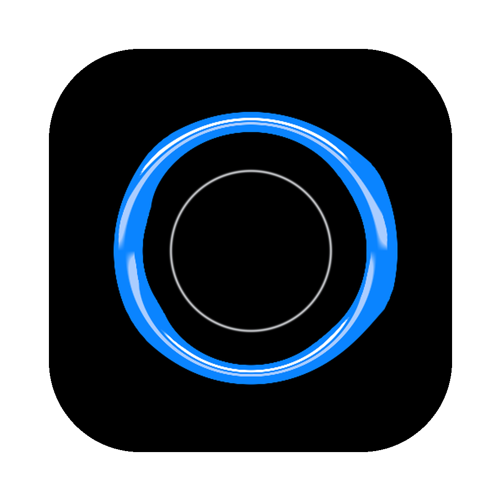

# Deskverse



Your desks from every parallel universe. A minimal native macOS app that keeps every desk you have worked at and brings any of them back from one sentence.

People keep dozens of tabs, terminals and AI agent sessions open because a visible tab is the only reminder they trust: close it and you lose your place. Deskverse saves each desk (Chrome tabs, Claude Code agent sessions, Obsidian notes, music), groups it by topic with no filing, and lays a whole desk back out on a blank macOS Desktop when you ask for it: browser left, notes top right, agents bottom right. Each desk carries a "Left off" line and a receipt of what it could not keep. It never closes, moves or edits anything, and it runs entirely on the Mac.

Built by Hao Lan during the Meta Global AI Developer Hackathon week, with AI coding agents (Claude Code and Codex). Deskverse's own intelligence is Meta's Llama 3.1, running on the Mac.

## Meta's Llama on the Mac

Deskverse runs Meta's Llama 3.1 8B (open weights) locally through Ollama at 127.0.0.1, falling back to Llama 3.2 3B. Llama names groups of tabs that have no project name, matches a sentence to the saved desk it means when no keyword does, and writes each desk's "Left off" line from tab and note titles and each agent's last message. Each desk is described to it by name, its "Left off" line and what was on it, and the answer is limited to real desk names. It asks twice with the desk list reversed and accepts only an answer that survives, so it says "no match" instead of guessing.

Tested on this Mac (2026-11-05, three runs each, about 0.4 s per pass): "my uni assignment about digital hoarding" found the thesis desk 3 of 3; "my guitar lessons" and "what was I watching last night" gave no match 3 of 3. Known limits: with a single desk saved, the vague "the thing for my landlord" still matched it 3 of 3; Llama 3.2 3B could not link "digital hoarding" to the thesis desk at all, which is why 3.1 8B is used when installed.

## Build and run

Requires macOS 26 or later, Xcode 27 (Swift 6.4), and Ollama with `ollama pull llama3.1:8b` (or `llama3.2:3b`).

```
scripts/build.sh
open build/EOU.app   # the app shows as Deskverse
```

Press Shift+Command+Space. Allow Accessibility (to lay windows out and find an empty Desktop) and Automation for Chrome, iTerm2, Finder and Spotify when macOS asks. Checks: `build/EOU.app/Contents/MacOS/EOU --dry-run --selftest`, and `--dry-run --ask "a sentence"` to watch Llama's two passes.

Code map and design rules: `AGENTS.md`.
